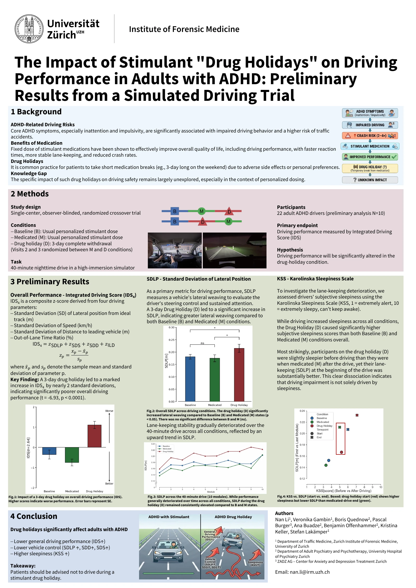
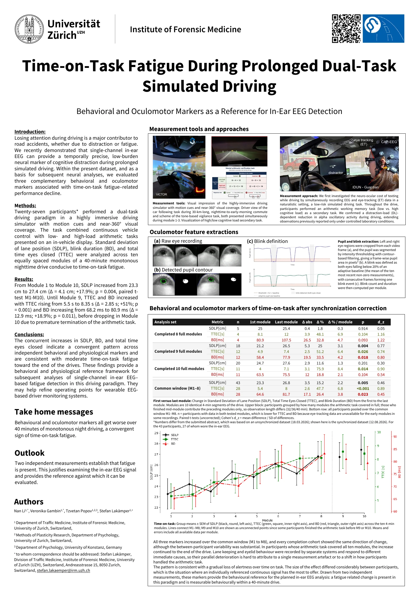
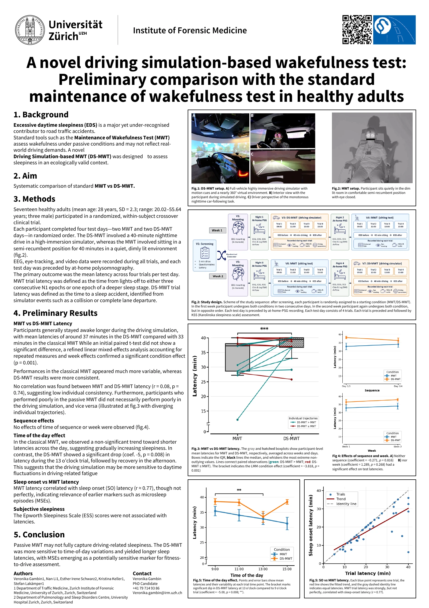
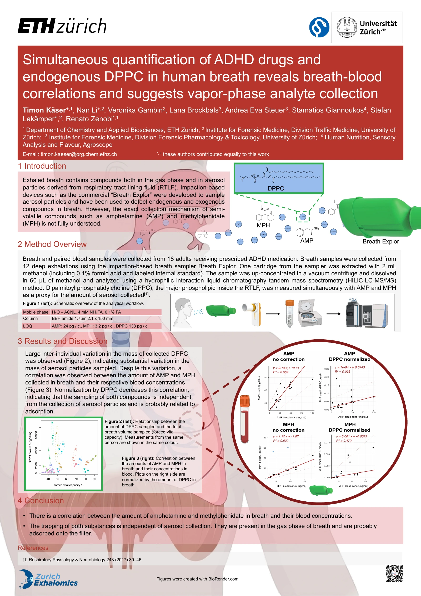
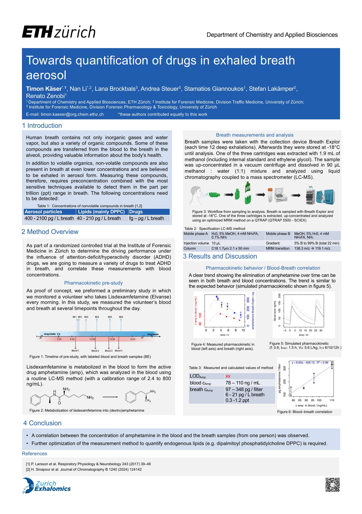

# Posters

## Sleep Europe 2026

**Oct. 2026 · Maastricht, Netherlands**

28th Congress of the European Sleep Research Society (ESRS).

<section class="poster-entry" id="sleep-europe-2026-adhd1" aria-labelledby="sleep-europe-2026-adhd1-title">
  <h3 id="sleep-europe-2026-adhd1-title">The Impact of Stimulant &quot;Drug Holidays&quot; on Driving Performance in Adults with ADHD: Preliminary Results from a Simulated Driving Trial</h3>
  
<strong>Nan Li</strong>, Veronika Gambin, Boris Quednow, Pascal Burger, Ana Buadze, Benjamin Offenhammer, Kristina Keller, Stefan Lakämper

  <figure class="poster-preview">
    
    <figcaption><a href="/posters/ESRS2026-ADHD1.pdf">View poster PDF</a></figcaption>
  </figure>
</section>

<section class="poster-entry" id="sleep-europe-2026-imbraid-iii" aria-labelledby="sleep-europe-2026-imbraid-iii-title">
  <h3 id="sleep-europe-2026-imbraid-iii-title">Time-on-Task Fatigue During Prolonged Dual-Task Simulated Driving</h3>
  
<em>Behavioral and Oculomotor Markers as a Reference for In-Ear EEG Detection</em>

  
<strong>Nan Li</strong>, Veronika Gambin, Tzvetan Popov, Stefan Lakämper

  <figure class="poster-preview">
    
    <figcaption><a href="/posters/ESRS2026-Imbraid%20III.pdf">View poster PDF</a></figcaption>
  </figure>
</section>

<section class="poster-entry" id="sleep-europe-2026-mwt2" aria-labelledby="sleep-europe-2026-mwt2-title">
  <h3 id="sleep-europe-2026-mwt2-title">A novel driving simulation-based wakefulness test: Preliminary comparison with the standard maintenance of wakefulness test in healthy adults</h3>
  
Veronika Gambin, <strong>Nan Li</strong>, Esther Irene Schwarz, Kristina Keller, Stefan Lakämper

  <figure class="poster-preview">
    
    <figcaption><a href="/posters/ESRS2026-MWT2.pdf">View poster PDF</a></figcaption>
  </figure>
</section>

## SGMS 2026

<section class="poster-entry" id="sgms-2026-adhd-drugs" aria-labelledby="sgms-2026-adhd-drugs-title">
  <h3 id="sgms-2026-adhd-drugs-title">Simultaneous quantification of ADHD drugs and endogenous DPPC in human breath reveals breath-blood correlations and suggests vapor-phase analyte collection</h3>
  
Timon Käser+, <strong>Nan Li</strong>+, Veronika Gambin, Lana Brockbals, Andrea Eva Steuer, Stamatios Giannoukos, Stefan Lakämper*, Renato Zenobi*

  
<small>*, + These authors contributed equally to this work.</small>

  <figure class="poster-preview">
    
    <figcaption><a href="/posters/SGMS2026.pdf">View poster PDF</a></figcaption>
  </figure>
</section>

## SCS 2025

<section class="poster-entry" id="scs-2025-drugs-in-exhaled-breath" aria-labelledby="scs-2025-drugs-in-exhaled-breath-title">
  <h3 id="scs-2025-drugs-in-exhaled-breath-title">Towards quantification of drugs in exhaled breath aerosol</h3>
  
Timon Käser*, <strong>Nan Li</strong>*, Lana Brockbals, Andrea Steuer, Stamatios Giannoukos, Stefan Lakämper, Renato Zenobi

  
<small>* These authors contributed equally to this work.</small>

  <figure class="poster-preview">
    
    <figcaption><a href="/posters/SCS2025.pdf">View poster PDF</a></figcaption>
  </figure>
</section>

